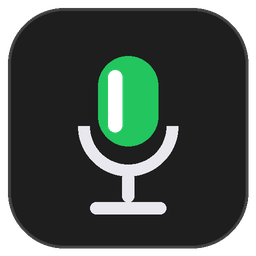
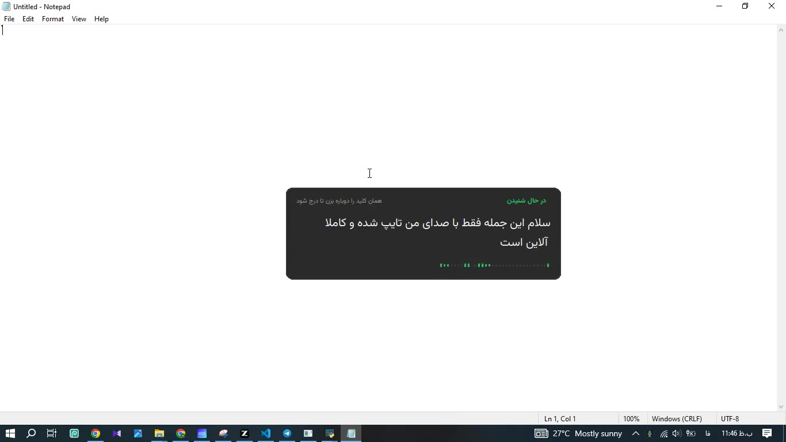
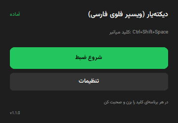
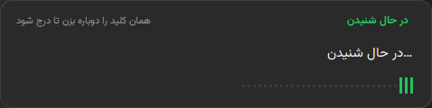
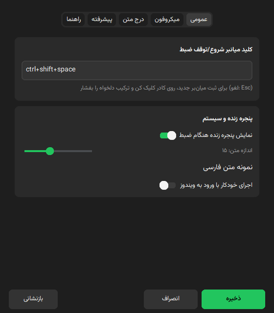
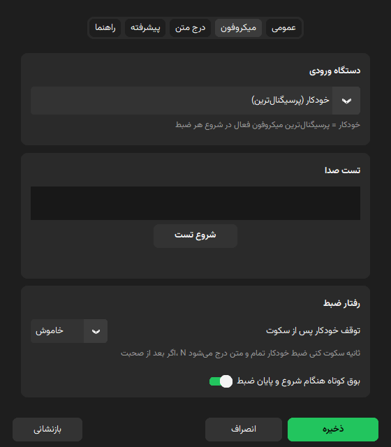
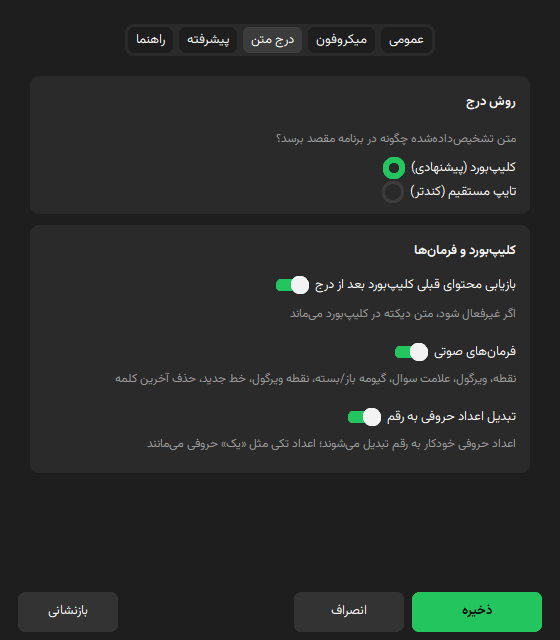
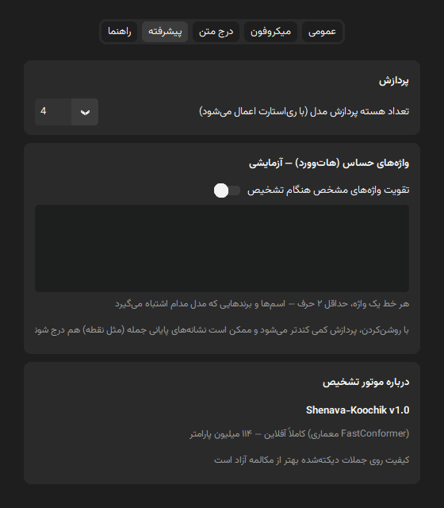
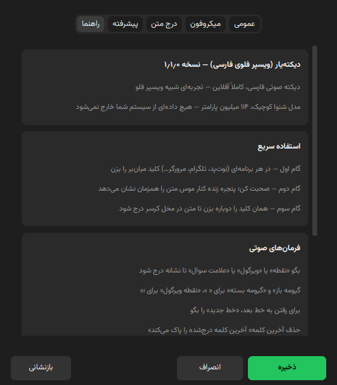

<div align="center">



**فارسی** | [English](README.en.md)

</div>

# دیکته‌یار (DikteYar)

دیکته‌ی گفتار فارسی، کاملاً آفلاین و لوکال — با یک کلید میانبر از هر برنامه‌ای. تجربه‌ای شبیه Wispr Flow، بدون اینکه حتی یک بایت صدا از سیستم شما خارج شود.

> 💚 **با سپاس فراوان از [Reza2kn](https://github.com/Reza2kn)** سازنده‌ی مدل [شنوا کوچیک (Shenava Koochik v1.0)](https://huggingface.co/Reza2kn/Shenava-Koochik-v1.0) که قلب این اپ است. این پروژه بدون مدل متن‌باز و باکیفیت ایشان وجود نداشت. اگر این اپ برایتان مفید بود، لطفاً مدل و [پروژه Shenava-1](https://github.com/Reza2kn/shenava-1) ایشان را هم ستاره کنید.
>
> 🙏 **و سپاس از [mallahyari (mehdi-hf)](https://huggingface.co/mehdi-hf/nemotron-asr-streaming-farsi)** سازنده‌ی فاین‌تیون فارسی [نیموترون استریمینگ](https://huggingface.co/Nimaone/nemotron-asr-streaming-farsi-onnx) (بر پایه‌ی [NVIDIA nemotron-3.5-asr-streaming-0.6b](https://huggingface.co/nvidia/nemotron-3.5-asr-streaming-0.6b)) که حالا به‌عنوان مدل «دقیق‌تر» در دسترس است.

<div align="center">
<a href="docs/demo.mp4"></a>
</div>

🎬 **دموی ویدیویی ۳۰ ثانیه‌ای (با صدا)** — دیکته در نوت‌پد: پنجره‌ی زنده کنار موس، فرمان صوتی «خط جدید»، و تبدیل «بیست و سه» به ۲۳ هنگام درج. (فایل: [docs/demo.mp4](docs/demo.mp4) — پوستر: [docs/demo-poster.jpg](docs/demo-poster.jpg))

https://github.com/user-attachments/assets/b8c6a8cd-9f77-40a1-adb9-305340b48e58

🎬 **دموی ایجنت‌محور ۸۰ ثانیه‌ای (با صدا)** — تور تنظیمات، دیکته‌ی یک درخواست اصلاحی داخل ZCode و اجرای آن توسط ایجنت: دکمه‌های ذخیره/انصراف/بازنشانی هم‌عرض می‌شوند و لبه‌هایشان با کارت‌های تب تراز می‌شود. (فایل: [docs/demo-agent.mp4](docs/demo-agent.mp4) — پوستر: [docs/demo-agent-poster.jpg](docs/demo-agent-poster.jpg))

https://github.com/user-attachments/assets/070fce67-3225-4949-b35c-9d734daae93b

- **مدل‌ها**: دو مدل قابل انتخاب — **شنوا کوچیک v1.0** (FastConformer NeMo CTC، ۱۱۴M، سبک/سریع، پیش‌فرض) و **نیموترون استریمینگ فارسی** (RNN-T، ۶۰۰M، دقیق‌تر) — هر دو از طریق sherpa-onnx و کاملاً آفلاین
- **زبان**: Python 3.12 — رابط کاربری CustomTkinter (بدون وابستگی GUI سنگین)
- **پلتفرم**: ویندوز ۱۰/۱۱ **۶۴بیتی (x64)** — **این اپ فقط برای ویندوز است** و روی ویندوز ARM اجرا نمی‌شود (هسته‌ی ماژول‌ها کراس‌پلتفرم است ولی رابط، درج متن و نصب‌کننده برای ویندوز x64 ساخته شده‌اند)
- **نسخه**: 1.3.0 — نصب‌کننده‌ی ویندوز (`DikteYar-Setup-1.3.0-x64.exe`) در [Releases](https://github.com/nimaone/persian-whisper-flow/releases/latest)

## ویژگی‌ها

- کلید میانبر سراسری قابل تغییر + پنجره زنده‌ی متن کنار نشانگر موس (با موس جابه‌جا می‌شود — از اولین کشیدن، جای انتخابی‌ات یادش می‌ماند)
- انتخاب مدل تشخیص گفتار از تنظیمات (شنوا کوچیک سبک / نیموترون دقیق‌تر) + دانلود همان مدل و تغییر پوشه‌ی مدل بدون نصب مجدد
- فرمان‌های صوتی نشانه‌گذاری (نقطه، ویرگول، گیومه، خط جدید، حذف آخرین کلمه)
- توقف خودکار ضبط پس از سکوت (قابل تنظیم: خاموش/۳/۵/۱۰ ثانیه)
- بوق کوتاه شروع/پایان ضبط
- مینیمایز پنجره اصلی به سینی ویندوز (Hidden Icons) + اجرای خودکار با ویندوز
- تشخیص خودکار میکروفون فعال + تست زنده با اسپیکتر و نشانگر کیفیت ورودی (نویز پایه/اوج/SNR) — تشخیص خودکار فقط دستگاه‌هایی را کاندید می‌گیرد که واقعاً استریم سالم باز می‌کنند
- درج متن با کلیپ‌بورد (با بازیابی محتوای قبلی) یا تایپ مستقیم یونیکد
- رابط کاربری فارسی RTL، تم Fluent تیره، بدون فلش سفید هنگام باز شدن

## نمای برنامه

| | |
|---|---|
|  |  |
| **پنجره اصلی** — وضعیت و شروع/توقف ضبط | **پنجره زنده** — متن در حال تشخیص کنار موس |
|  |  |
| **تنظیمات — عمومی** | **تنظیمات — میکروفون** (تست زنده با اسپیکتر) |
|  |  |
| **تنظیمات — درج متن** | **تنظیمات — پیشرفته** (واژه‌های حساس/هات‌وورد) |
|  | |
| **تنظیمات — راهنما** | |

## نصب و اجرا

```bash
python -m venv .venv
.venv\Scripts\pip install -r requirements.txt
.venv\Scripts\python download_model.py   # دانلود مدل پیش‌فرض (شنوا کوچیک)
.venv\Scripts\python app\main.py
```

دو رابط کاربری موجود است — همان منطق ضبط/ترنسکرایب، فقط پوسته متفاوت:

```bash
.venv\Scripts\python app\main.py          # UI فعلی (CustomTkinter)
.venv\Scripts\python -m flet_ui.run       # UI جدید (Flet) — برنامه‌ی کامل
.venv\Scripts\python -m flet_ui.run demo  # فقط نمایش UI، بدون مدل/میکروفون
```

> UI جدید (Flet) همان چرخه‌ی عمر را دارد: بدون مدل → صفحه‌ی اولین اجرا برای انتخاب/دانلود مدل → اپ اصلی؛ مینیمایز → سینی، بستن پنجره → خروج کامل.

## مدل‌ها

مدل همراه مخزن نیست. ساده‌ترین راه دانلود خودکار است:

```bash
.venv\Scripts\python download_model.py                 # مدل پیش‌فرض (شنوا کوچیک)
.venv\Scripts\python download_model.py nemotron-farsi  # مدل دقیق‌تر (نیموترون)
.venv\Scripts\python download_model.py --list          # فهرست مدل‌ها
```

| مدل | معماری | حجم | سرعت | دقت | هات‌وورد |
|---|---|---|---:|---|---|
| **شنوا کوچیک v1.0** (پیش‌فرض) | FastConformer NeMo CTC، ۱۱۴M | ~۴۴۰MB | سریع | پایه | ✓ |
| **نیموترون استریمینگ فارسی** | RNN-T، ۶۰۰M | ~۶۶۷MB | ~۴ برابر کندتر | دقیق‌تر | ✗ |

- فایل‌های شنوا در `model/` (`model.onnx` + `tokens.txt`) و فایل‌های نیموترون در `model/nemotron/` (`encoder/decoder/joiner.int8.onnx` + `tokens.txt`) قرار می‌گیرند.
- در نبود اینترنت، فایل‌ها را دستی از HuggingFace بگیرید: [شنوا](https://huggingface.co/Reza2kn/Shenava-Koochik-v1.0-sherpa-onnx) · [نیموترون](https://huggingface.co/Nimaone/nemotron-asr-streaming-farsi-onnx).
- مدل فعال هر وقت بخواهید از تنظیمات → تب «عمومی» → کارت «مدل تشخیص گفتار» عوض می‌شود (موتور بعد از «ذخیره» خودکار بازسازی می‌گردد).
- مدل نیموترون transducer است: تقویت هات‌وورد و «متن زنده‌ی پایدار» رویش اعمال نمی‌شود.

## استفاده

1. اپ اجرا شود → آیکون در سینی ویندوز (بعد از ~۳ ثانیه لود مدل: «آماده»)
2. در هر برنامه‌ای (نوت‌پد، تلگرام، مرورگر…) **Ctrl+Shift+Space** بزنید و صحبت کنید
3. پنجره زنده کنار موس، متن در حال تشخیص را نشان می‌دهد
4. همان کلید را دوباره بزنید → متن در محل کرسر درج می‌شود
5. **مینیمایز** پنجره اصلی → اپ در سینی ویندوز می‌ماند (بخش Hidden Icons)؛ **دابل‌کلیک روی آیکون سینی** یا منوی «نمایش پنجره» آن را برمی‌گرداند

## فرمان‌های صوتی

| بگو | نتیجه |
|---|---|
| «نقطه» | . |
| «ویرگول» | ، |
| «علامت سوال» | ؟ |
| «گیومه باز» / «گیومه بسته» | « / » |
| «نقطه ویرگول» | ؛ |
| «خط جدید» | Enter |
| «حذف آخرین کلمه» | پاک‌کردن آخرین کلمه (Ctrl+Backspace) |

نکته: کلمات تک‌واژه‌ای که در گفتار عادی هم می‌آیند (مثل «سوال») به‌عنوان فرمان شنیده نمی‌شوند تا جمله‌های عادی خراب نشوند — برای علامت سوال عبارت کامل «علامت سوال» را بگو.

## تنظیمات

از منوی سینی → «تنظیمات». پنجره پنج تب دارد (همه‌ی تغییرات با «ذخیره» اعمال می‌شوند؛ «بازنشانی» به پیش‌فرض‌ها برمی‌گرداند) — همان کارت «پوشه مدل» در نسخه‌ی customtkinter هم هست:

- **عمومی**: کلید میانبر (روی کادر کلیک کنید و ترکیب را بفشارید — ترکیب باید Ctrl/Alt/Shift داشته باشد یا کلید F؛ Esc لغو می‌کند)، بوق شروع/پایان ضبط، پنجره زنده + اندازه فونت متن آن، اجرای خودکار با ویندوز، **مدل تشخیص گفتار** (انتخاب بین «شنوا کوچیک» سبک و «نیموترون» دقیق‌تر + دکمه‌ی «دانلود مدل انتخابی»)، **پوشه مدل** (با «مرور…» پوشه‌ای که فایل‌های مدل در آن است انتخاب کنید؛ «پیش‌فرض» = پوشه کنار برنامه — اگر پوشه انتخابی خالی باشد دانلود همان‌جا انجام می‌شود و تغییر پس از ذخیره با بازخوانی مدل اعمال می‌شود)
- **میکروفون**: دستگاه ورودی («خودکار» = پرسیگنال‌ترین میکروفون در شروع هر ضبط)، تست صدا با اسپیکتر زنده، توقف خودکار پس از سکوت
- **درج متن**: روش درج (کلیپ‌بورد پیشنهادی / تایپ مستقیم)، بازیابی محتوای قبلی کلیپ‌بورد، فعال/غیرفعال‌کردن فرمان‌های صوتی
- **پیشرفته**: تعداد thread پردازش مدل (با ری‌استارت اپ اعمال می‌شود)، واژه‌های حساس/هات‌وورد (آزمایشی)، درباره‌ی موتور تشخیص
- **راهنما**: نسخه‌ی برنامه، راهنمای سریع، فرمان‌های صوتی و نکته‌های رفع اشکال

## ساختار پروژه

```
model/              مدل ASR فعال (شنوا: model.onnx + tokens.txt / نیموترون: model/nemotron/)
app/
  main.py           نقطه ورود — tray + hotkey + حلقه UI + توقف خودکار سکوت
  asr.py            موتور تشخیص sherpa-onnx (CTC) + ترنسکرایپ زنده/نهایی
  asr_nemotron.py   موتور/نشست نیموترون (RNN-T استریمینگ، sherpa-onnx)
  models_catalog.py کاتالوگ مدل‌ها (شناسه/نوع/فایل‌ها/آدرس دانلود/متادیتای نمایشی)
  engine_factory.py ساخت موتور فعال بر اساس مدل انتخاب‌شده (CTC یا transducer)
  model_download.py دانلود فایل‌های مدل انتخابی + نگهبان دانلود ناقص
  first_run.py      دیالوگ اولین اجرا: انتخاب/دانلود مدل (نسخه CTk)
  hotword_asr.py    موتور جایگزین beam search + هات‌وورد (pyctcdecode، اختیاری)
  recorder.py       ضبط sounddevice + ری‌سمپل افزایشی 16kHz + تشخیص میکروفون
  overlay.py        پنجره زنده فریم‌لس گوشه‌گرد با موج سطح (بدون دزدیدن فوکوس)
  paster.py         درج در محل کرسر: کلیپ‌بورد (بکاپ/بازیابی) یا تایپ مستقیم
  voice_commands.py فرمان‌های صوتی فارسی → نشانه/کلید
  config.py         تنظیمات JSON در %APPDATA%\WhisperFlowFarsi + autostart رجیستری
  theme.py          پالت Fluent تیره (یک accent سبز) + بارگذاری لوگو
  win32.py          DWM تیره/گوشه‌گرد، نمایش نرم بدون فلش سفید، مین/ماکس دیالوگ
  control_window.py پنجره کنترل (مینیمایز → سینی)
  settings_ui.py    تنظیمات پنج‌تب + انتخاب مدل + کپچر میانبر + تست میکروفون
  fonts.py          رجیستر فونت وزیرمتن فقط برای پروسه (AddFontResourceEx)
flet_ui/            رابط کاربری جدید فلت — نقطه ورود: run.py (`python -m flet_ui.run`)
download_model.py   CLI دانلود مدل (مدل انتخابی یا --list)
assets/             لوگو (logo.png / logo.ico) + فونت وزیرمتن
spikes/             ابزارهای CLI تست + اسکریپت تولید لوگو
```

## نکات فنی

- مدل کاملاً آفلاین است؛ نمایش «زنده» با اجرای مجدد inference روی پنجره‌ی ۱۰ ثانیه‌ای آخر هر ۸۰۰ms ساخته می‌شود (تأخیر inference روی CPU حدود ۰.۰۴ برابر طول صدا).
- **پیشوند پایدار متن زنده (اختیاری)**: برای اینکه متنِ در حال دیکته چشمک‌نزند، واژه‌های پذیرفته‌شده قفل می‌شوند و یک واژه‌ی تازه فقط وقتی وارد متن پایدار می‌شود که سه شرط را داشته باشد: در پنجره‌های قبلی هم دیده شده باشد (رأی بین‌پنجره‌ای) یا اطمینان خیلی بالا داشته باشد؛ رقیب هم‌زمان نداشته باشد (مدل در آن جایگاه مدام متن دیگری نگفته باشد)؛ و روی لبه‌ی در حال خروج پنجره نباشد (واژه‌ی نصف‌بریده). تطبیق واژه‌ها به نیم‌فاصله (ZWNJ) حساس نیست. نمایش کاربر = **کل متن قفل‌شده + پنجره‌ی جاری**: وقتی پنجره جلو می‌رود، واژه‌های خارج‌شده به پیشوند قفل‌شده منتقل می‌شوند و دیگر عوض نمی‌شوند؛ پنجره‌ی جاری — واژه‌هایی که هنوز قطعی نشده‌اند — در پنجره‌ی زنده کم‌رنگ‌تر نشان داده می‌شود تا معلوم باشد کدام بخش قطعی و کدام در حال شکل‌گرفتن است. اگر متن از سقف ارتفاع کارت (کسری از ارتفاع صفحه) بلندتر شود، سرِ متن قطعی با «…» کوتاه می‌شود و کارت در هر به‌روزرسانی داخل صفحه نگه داشته می‌شود؛ پنجره‌ی جاری همیشه کامل دیده می‌شود. پنجره‌ی این حالت ۱۲ ثانیه است (آزمایش ۱۷: از ۱۶ ثانیه به بالا دقتی خریده نمی‌شود ولی هزینه‌ی هر tick به سقف ۸۰۰ms می‌چسبد) و خط زمانی واژه‌ها مطلق است (t_offset از ری‌کوردر). یک tick نویزی نمی‌تواند پیشوند قفل‌شده را پاک کند (گارد بازراه‌اندازی/حذف از ابتدا) و کاندیدِ بلندتر با اعتماد هم‌تر یا بالاتر («توضیح بهتر همان صدا») حق جایگزینی پیشوندی دارد که در پنجره‌های اول با کانتکست کم شکل دیگری گرفته بود. روی صدای واقعی کاربر (۱۴۳ ثانیه، سنجش روی پایپ‌لاین خود اپ با `_partial_loop` واقعی — spikes/speech_rate/experiment23): پوشش لحظه‌ای نمایش ۳۱٪ → ۷۳٪، WER نمایش لحظه‌ی توقف ۹۴٪ → ۵۱٪ و چمپ ۳٫۰ → ۲٫۰ واژه در هر tick؛ متن نهایی هم با مسیر جدید دیکد بدتر نشد (۳۴٫۱٪ → ۳۰٫۴٪ روی همان نمونه). اگر پنجره از متن نمایش‌داده‌شده کاملاً جلو بزند (مثلاً بعد از مکث بلند)، نمایش با متن تازه بازراه‌اندازی می‌شود تا قفل فریز نشود. این حالت پیش‌فرض خاموش است و از تب «پیشرفته» روشن می‌شود. متن نهایی هرگز از پیشوند قفل‌شده ساخته نمی‌شود و همیشه از دیکد تازه‌ی کل ضبط می‌آید، ولی چون موتور و مسیر دیکدش با حالت پیش‌فرض فرق دارد خروجی می‌تواند کمی متفاوت باشد: فقط یک session ONNX برای هر دو کار تشخیص و امتیازدهی لود می‌شود (حافظه‌ی جریان زنده تخت می‌ماند)، متن نهایی در chunkهای ۱۶ ثانیه‌ای decode می‌شود، و اصلاح واژه‌های ثبت‌شده (بخش بعد) در این حالت روی خروجی زنده و نهایی اعمال نمی‌شود.
- **حافظه‌ی مسیر پیش‌فرض**: پس از اولین ترنسکرایپ بلند، مصرف حافظه‌ی فرایند در مسیر پیش‌فرض (sherpa) بالا می‌رود و ثابت می‌ماند — arena داخلی ONNX Runtime است که به‌جای پس‌دادن حافظه به OS، آن را برای decodeهای بعدی نگه می‌دارد؛ سقف‌دار است، نشتی نیست و با بستن اپ آزاد می‌شود. حالت «متن زنده پایدار» این رفتار را ندارد.
- **Gating سکوت**: اگر ورودی میکروفون ادامه‌دار سکوت باشد، inference زنده اجرا نمی‌شود؛ تا ۱٫۵ ثانیه پس از آخرین صدای واقعی decode ادامه می‌دهد تا دنباله‌ی کلمات قطع نشود. این کار فشار CPU در مکث‌های بلند را کم می‌کند و روی مسیر پیش‌فرض و مسیر پایدار اثر یکسان دارد.
- **ری‌سمپل افزایشی**: هر بلوک صدا فقط یک‌بار پردازش می‌شود و partial فقط پنجره‌ی ۱۰ ثانیه‌ای انتهایی را می‌خواند — هزینه‌ی CPU مستقل از طول ضبط است. بافر حداکثر ۵ دقیقه نگه داشته می‌شود (بخش‌های قدیمی‌تر حذف می‌شوند).
- کلید میانبر با `suppress` ثبت می‌شود؛ ترکیب انتخابی فقط برای این اپ مصرف می‌شود و به برنامه‌ی مقصد نمی‌رسد.
- تشخیص خودکار میکروفون: در استارتاپ همه‌ی دستگاه‌های ورودی با ۰.۳۵s probe سنجیده می‌شوند و پرسیگنال‌ترین انتخاب می‌شود.
- درج با کلیپ‌بورد انجام می‌شود و متن قبلی بعد از درج (~۶۰۰ms برای برنامه‌های کند مثل Electron) بازیابی می‌گردد.
- پنجره‌ها با DWM عنوان تیره و گوشه‌ی گرد دارند و با alpha-fade بدون فلش سفید ظاهر می‌شوند.
- تنظیمات در `%APPDATA%\WhisperFlowFarsi\settings.json` ذخیره می‌شود (کلیدها: `hotkey`، `paste_method`، `voice_commands`، `persian_itn`، `rejoin_prefixes`، `enroll_alias`، `restore_clipboard`، `sound_feedback`، `overlay_enabled`، `overlay_font_size`، `auto_stop_sec`، `input_device`، `input_device_key`، `autostart`، `num_threads`، `hotword_boost`، `hotwords`، `stable_live`، `model_id` (شناسه‌ی مدل فعال — پیش‌فرض `shenava-koochik`؛ گزینه‌ی دیگر `nemotron-farsi`)، `model_dir` (پوشه مدل دلخواه — خالی/`null` یعنی پیش‌فرض کنار برنامه))؛ مدخل‌های ثبت صوتی در `enrollments.json` کنار آن. دستگاه ورودی پین‌شده با کلید پایدار (نام — Host API) هم ذخیره می‌شود تا جابه‌جایی ایندکس‌ها بین بوت‌ها انتخاب را خراب نکند.
- **ITN فارسی**: اعداد حروفی («بیست و سه»، «سی‌وپنج»، «سه ممیز چهارده») هنگام درج به رقم (۲۳، ۳۵، ۳٫۱۴) تبدیل می‌شوند — از تب «درج متن» در تنظیمات قابل خاموش‌کردن است. اعداد تکی کوچک («یک»، «هشت») عمداً حروفی می‌مانند تا متن طبیعی بماند. «و» بین دو عدد مستقل آنها را یکی نمی‌کند: «چهار و پنج» همان «چهار و پنج» می‌ماند (قبلاً ۴+۵ جمع می‌شد و «۹» درمی‌آمد) و فقط وقتی جزء با جای عددیِ کوچک‌تر بیاید یک عدد می‌سازد («صد و بیست» → ۱۲۰، «هزار و دویست» → ۱٬۲۰۰).
- **بازپیوند می/نمی**: مدل گاهی پیشوند فعل را جدا می‌نویسد («می کنم»)؛ چون در فارسی «می/نمی» هرگز واژه‌ی مستقل نیستند، توکن تنها به واژه‌ی بعدی چسبانده می‌شود («میکنم») — هم در متن زنده و هم در متن نهایی. روی ۳۵۰ کلیپ سنجیده شده و ۱۵۱ خطا را کم کرده است؛ با کلید `rejoin_prefixes` در settings.json قابل خاموش‌کردن است.
- **ثبت صوتی واژه (enrollment) — آزمایشی**: اگر مدل واژه‌ای را مدام غلط می‌شنود («ویسپرفلو»، «ای‌آی» و اسم‌ها/برندها)، از تب «پیشرفته» واژه را ضبط کن؛ شکل‌هایی که مدل می‌شنود فهرست می‌شوند و با تأیید خودت، در خروجی زنده و نهایی به واژه‌ی درست تبدیل می‌شوند (نگاشت به شکل/نیم‌فاصله حساس نیست، واریانت به‌صورت عبارت کامل گرفته می‌شود و تکه‌کلمه‌ها را خراب نمی‌کند). این لایه در حالت «متن زنده پایدار» اعمال نمی‌شود — گویش دیکد beam-2 با گویشی که واریانت‌ها برداشت شده‌اند فرق دارد. تطبیق علاوه بر شکل دقیق، فازی هم هست (توکن‌های ≥۵ حرف با کلیدهای ≥۶ حرف و شباهت ≥۸۰٪) چون decode پنجره‌ی زنده و decode نهایی همان واژه را اندکی متفاوت می‌شنوند؛ در دیالوگ ثبت/ویرایش واریانت دستی هم می‌توان تایپ کرد — دقیق‌ترین منبع، همان شکلی است که در متن زنده دیده می‌شود. مدخل‌ها در `enrollments.json` کنار settings.json ذخیره می‌شوند؛ سوییچ «اصلاح واژه‌های ثبت‌شده» یا کلید `enroll_alias` لایه را خاموش می‌کند. در حالت هات‌وورد، واژه‌های ثبت‌شده خودکار به فهرست تقویت beam search اضافه می‌شوند.
- **واژه‌های حساس (هات‌وورد) — آزمایشی، پیشفرض خاموش**: تب «پیشرفته». برای اسم‌ها/برندهایی که مدل مدام اشتباه می‌گیرد («کلاود»، «جمنای»، «اپ» و…). با روشن‌کردن، دیکد از گری‌دی sherpa-onnx به beam search (pyctcdecode + onnxruntime) با تقویت هات‌وورد تغییر می‌کند. پردازش کمی کندتر می‌شود؛ ممکن است نشانه‌های پایانی جمله (مثل «.») هم درج شوند؛ و همه خطاها اصلاح نمی‌شود («اپ» بعد از «با» حتی با این حالت ممکن است «آب» بماند — محدودیت آکوستیک مدل). واژه‌های خیلی رایج را در لیست نگذارید. تغییرات بلافاصله بعد از ذخیره اعمال می‌شود (اگر وسط ضبط باشید، بعد از پایان همان ضبط).

## محدودیت‌ها

- در برنامه‌های run-as-administrator درج کار نمی‌کند (محدودیت ویندوز).
- بازیابی کلیپ‌بوردِ غیرمتنی (عکس/فایل) ممکن نیست — در آن حالت متن دیکته در کلیپ‌بورد می‌ماند.
- کیفیت روی جملات دیکته‌شده بهتر از مکالمه‌ی آزاد است.
- بافر ضبط به ۵ دقیقه محدود است (ضبط‌های طولانی‌تر از ابتدا حذف می‌شوند).

## عیب‌یابی

- **هیچ صدایی تشخیص داده نمی‌شود** → تب میکروفون → «تست صدا» را اجرا کنید؛ اگر «سیگنالی نمی‌آید» بود دستگاه دیگری را امتحان کنید یا «خودکار» را نگه دارید.
- **متن در برنامه‌ی مقصد درج نمی‌شود** → اگر برنامه Run-as-Administrator است، اپ را هم با دسترسی admin اجرا کنید یا روش درج را «تایپ مستقیم» بگذارید.
- **متن ناقص درج می‌شود** → برنامه‌ی مقصد کند است؛ اگر با روش کلیپ‌بورد حل نشد، روش «تایپ مستقیم» را امتحان کنید.
- **میان‌بر با برنامه‌ی دیگری تداخل دارد** → از تب عمومی یک ترکیب جدید بگیرید (مثلاً Ctrl+Alt+D).

## توسعه

```bash
python -m venv .venv
.venv\Scripts\pip install -r requirements.txt
.venv\Scripts\python app\main.py
```

- بازتولید لوگو: `.venv\Scripts\python spikes\make_logo.py` (خروجی: `assets/logo.png` و `assets/logo.ico`)
- تست‌ها: `.venv\Scripts\python -m pytest tests/` (۳۱۵ تست؛ شامل دانلود چندمدلی، انتخاب مدل و اولین اجرا)
- دانلود مدل از CLI: `.venv\Scripts\python download_model.py [model-id]` یا `--list`
- تست ترنسکرایپ CLI: `spikes/transcribe_cli.py` — ضبط آزمایشی: `spikes/record_cli.py` — تولید صوت آزمایشی: `spikes/gen_test_wav.py` — A/B هات‌وورد: `spikes/hotword_test.py` (کلیپ‌های تست در `spikes/test_app/` — لوکال، داخل گیت نیست)
- بازتولید اسکرین‌شات‌های README: `.venv\Scripts\python spikes\make_screenshots.py control|overlay|settings`

## ساخت exe ویندوز (شاخه feature/exe-installer)

```bash
.venv\Scripts\pip install pyinstaller
.venv\Scripts\python.exe -m PyInstaller dikteyar.spec --noconfirm
```

خروجی: `dist/DikteYar/` — پوشه‌ی قابل zip (نسخه پرتابل). نکته‌ها:

- **onedir نه onefile** — استارت فوری؛ onefile هر بار ~۱۵۰MB را به temp اکسترکت می‌کند و با هوک کیبورد و آنتی‌ویروس اذیت می‌کند
- **مدل داخل بسته نیست** (نصب‌کننده سبک) — در اولین اجرا دیالوگ می‌آید: مدل را انتخاب کنید (**شنوا کوچیک** ~۴۴۰MB پیش‌فرض/سریع یا **نیموترون** ~۶۶۷MB دقیق‌تر) و دانلود خودکار بزنید، یا «انتخاب دستی» پوشه‌ای که کاربر خودش فایل‌ها را در آن گذاشته. دانلود در پوشه‌ی انتخاب‌شده در تنظیمات انجام می‌شود و بعد از نصب هم می‌توان از تب «عمومی» مدل و پوشه مدل را عوض کرد
- `version_info.txt` مشخصات ویندوزی (نام/نسخه/آیکون در Properties) را می‌دهد
- برای تست کامل، `model/` را کنار `DikteYar.exe` کپی کنید تا دیالوگ اولین اجرا رد شود

### نصب‌کننده (Inno Setup)

```bash
winget install JRSoftware.InnoSetup
"C:\Users\<you>\AppData\Local\Programs\Inno Setup 6\ISCC.exe" installer\dikteyar.iss
```

خروجی: `installer/Output/DikteYar-Setup-1.3.0-x64.exe` (~۳۶MB). مشخصات: نصب **per-user** در `%LOCALAPPDATA%\Programs\DikteYar` بدون نیاز به دسترسی مدیر، شورتکات اختیاری دسکتاپ، تیک اجرای خودکار با ویندوز، و حذف مدل از محتوا (نصب‌کننده سبک می‌ماند حتی اگر برای تست مدل کنار exe باشد).

## لایسنس و سپاس‌ها

- کد این اپ («دیکته‌یار»): **Apache-2.0** — فایل [LICENSE](LICENSE) (هم‌خانواده با لایسنس مدل)
- مدل «شنوا کوچیک v1.0» (Shenava Koochik v1.0) اثر Reza2kn: **Apache-2.0** — فایل [model/LICENSE](model/LICENSE)
  · [نسخه sherpa-onnx مدل](https://huggingface.co/Reza2kn/Shenava-Koochik-v1.0-sherpa-onnx) · [پروژه Shenava-1](https://github.com/Reza2kn/shenava-1)
- مدل «نیموترون استریمینگ فارسی» (نسخه sherpa-onnx int8) اثر mallahyari (mehdi-hf): **OpenMDW 1.1** — فاین‌تیون از [mehdi-hf/nemotron-asr-streaming-farsi](https://huggingface.co/mehdi-hf/nemotron-asr-streaming-farsi) بر پایه‌ی معماری [NVIDIA nemotron-3.5-asr-streaming-0.6b](https://huggingface.co/nvidia/nemotron-3.5-asr-streaming-0.6b)
  · [نسخه ONNX](https://huggingface.co/Nimaone/nemotron-asr-streaming-farsi-onnx) · [جزئیات کامل](nemotron/hf_upload/README_FA.md)
- جزئیات کامل مدل (پارامترها، دیتاست‌های آموزش، متریک‌ها): [model/README.md](model/README.md)
- انتساب همه‌ی اجزای ثالث: [NOTICE](NOTICE)
